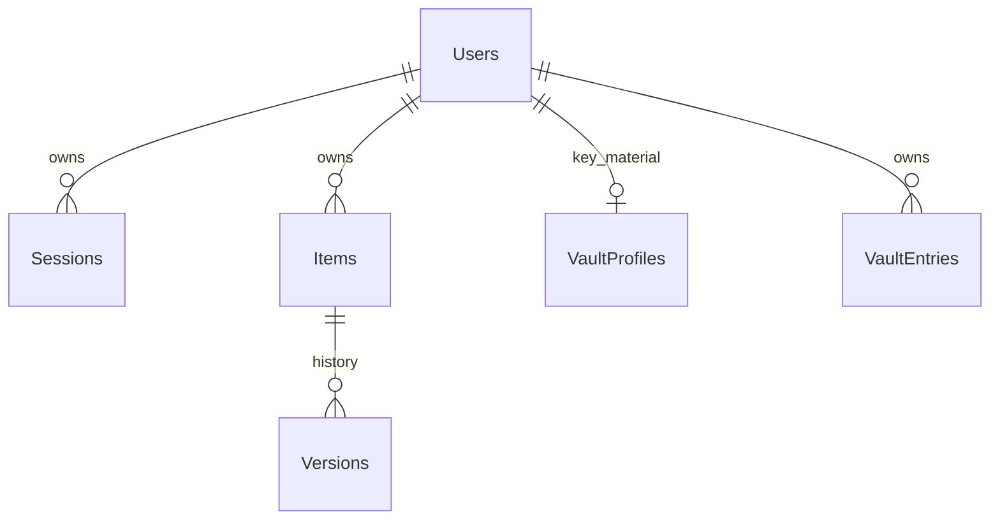

# TuckNote

Kho cá nhân cho Inbox, ghi chú, link và Két bí mật. Backend ASP.NET Core 10 + EF Core 10 + SQL Server; giao diện React/TypeScript. Giao diện tiếng Việt, tối ưu desktop và điện thoại. Không có đăng ký công khai.

## Trạng thái hiện tại

- Dự án gốc là mẫu ASP.NET Core trống. Không có `AGENTS.md` hoặc Git trong thư mục này lúc bắt đầu.
- Đã kiểm tra `NSHLONG\SQLEXPRESS` bằng Windows Authentication: database `TuckNote` chưa có trong danh sách nhìn thấy được bởi tài khoản hiện tại. **Chưa tạo hoặc sửa database này.** Cần SQL Authentication của bạn trước khi triển khai.
- Môi trường phát triển dùng SQL Server LocalDB database `TuckNoteDev`; migration `InitialCreate` đã áp dụng. Không có tài khoản chủ sở hữu hay dữ liệu mẫu trong database phát triển.
- Chưa triển khai ra Internet vì chưa có thông tin SQL Authentication, tên miền và chứng chỉ HTTPS tin cậy.

## Cấu trúc

| Thư mục | Chức năng |
| --- | --- |
| `Tucknote/Data` | Entity và migration SQL Server |
| `Tucknote/Features` | API Auth, Items, Vault, Backup |
| `client/src` | React, API, trình soạn thảo, két, mã hóa Web Crypto |
| `Tucknote.Tests` | Kiểm thử tích hợp với SQL Server LocalDB riêng |
| `Tucknote/wwwroot` | Giao diện đã build để ASP.NET phục vụ cùng origin |

Các bảng: `Users` (tài khoản), `Sessions` (phiên có thể thu hồi), `Items` (Inbox, ghi chú, link, xóa mềm), `Versions` (lịch sử), `VaultProfiles` (salt/KDF/khóa được bọc), `VaultEntries` (ciphertext, IV). Mọi bản ghi nghiệp vụ có `UserId`; mọi truy vấn API kiểm tra người sở hữu. `Revision` bảo vệ thay đổi đồng thời. Giao diện báo xung đột và giữ bản nháp để lưu thành bản sao.



## Chạy trên máy phát triển

Cần .NET SDK 10, Node.js 20+ và `pnpm`; SQL Server LocalDB. Cài công cụ EF Core cùng major version nếu máy chưa có: `dotnet tool install --global dotnet-ef --version 10.0.14`. Chạy từ thư mục gốc dự án:

```powershell
cd client
pnpm install
pnpm build
cd ..\Tucknote
dotnet ef database update -- --environment Development
```

Trên máy phát triển hiện tại, mã thiết lập một lần đã được tạo trong .NET User Secrets. Xem mã bằng `dotnet user-secrets list` khi đang ở thư mục `Tucknote`. Nếu chuyển dự án sang máy khác hoặc cần tạo mã mới, dùng lệnh sau; giá trị chỉ hiện trong terminal của bạn và nằm ngoài source:

```powershell
$setupToken = [Convert]::ToHexString([Security.Cryptography.RandomNumberGenerator]::GetBytes(32))
dotnet user-secrets set BootstrapToken $setupToken
Write-Host "Mã thiết lập: $setupToken"
dotnet run --launch-profile https
```

Mở `https://localhost:7056`, nhập email, mật khẩu đăng nhập (ít nhất 12 ký tự), mã thiết lập. Sau khi tạo tài khoản, xóa `BootstrapToken` khỏi User Secrets và khởi động lại ứng dụng:

```powershell
dotnet user-secrets remove BootstrapToken
```

Nếu chứng chỉ phát triển chưa được tin cậy, dùng `dotnet dev-certs https --trust` trên máy phát triển rồi tải lại trang. Không bỏ qua cảnh báo chứng chỉ trong trình duyệt để thử nghiệm két với dữ liệu thật.

## Sử dụng

- **Lưu nhanh** từ mọi màn hình hoặc `Ctrl+K`; mục vào Inbox. Bản nháp ghi nhanh và ghi chú lưu tạm trên thiết bị nếu mạng lỗi; giao diện báo trạng thái. Inbox có thể đổi thành ghi chú hoặc link.
- **Ghi chú/link**: sửa tự động sau khi ngừng gõ, thẻ, nhóm chủ đề, ghim, lưu trữ, xóa mềm, khôi phục, lịch sử phiên bản và tìm kiếm. Nội dung dùng Markdown cơ bản và được hiển thị bằng React Markdown, không cho HTML thô chạy.
- **Két bí mật**: đặt mật khẩu chính riêng, lưu recovery key, mở khóa trên thiết bị. Mọi trường trong mục két được gói trong JSON rồi mã hóa AES-GCM bằng khóa dữ liệu ngẫu nhiên. Khóa dữ liệu được bọc bằng khóa PBKDF2-SHA256 (600.000 vòng, salt riêng) và một recovery key ngẫu nhiên 256 bit. SQL Server chỉ lưu ciphertext, IV và hồ sơ bọc khóa. Tìm kiếm két chỉ chạy sau giải mã trong trình duyệt. Két tự khóa sau 5 phút không hoạt động hoặc khi rời tab. Những thay đổi két gửi thất bại được giữ trên thiết bị **dưới dạng ciphertext** để thử đồng bộ lại.
- Mở két không gọi endpoint giải mã: mật khẩu chính không rời thiết bị. Endpoint lấy hồ sơ két được giới hạn tốc độ; PBKDF2 làm chậm thử khóa ngoại tuyến. Không thể đảm bảo rate limit từ server đối với kẻ đã lấy được bản ciphertext, vì vậy mật khẩu chính dài và recovery key được giữ riêng là thiết yếu.
- **Sao lưu**: Cài đặt → Xuất bản sao lưu tạo tệp JSON được mã hóa AES-GCM với mật khẩu sao lưu riêng; nhập lại bằng mật khẩu đó. Ghi chú được nhập thành bản mới để không ghi đè. Mục két có thể nhập vào tài khoản chưa có két hoặc két dùng đúng cùng bộ khóa; két khác khóa sẽ bị từ chối. Giữ tệp, mật khẩu sao lưu và recovery key ở nơi an toàn. Mất cả mật khẩu chính và recovery key sẽ mất quyền truy cập dữ liệu két.

## Kiểm thử

```powershell
dotnet test .\Tucknote.slnx
cd client
pnpm test
pnpm build
pnpm audit
```

Test tích hợp tạo database LocalDB có tên ngẫu nhiên, chạy migration, kiểm tra thiết lập/đăng nhập, giới hạn người dùng, CRUD, tìm kiếm, xung đột, phiên bản, thùng rác, sao lưu/khôi phục và API két, sau đó chỉ xóa database thử do test tự tạo. Test Web Crypto kiểm tra giải mã, khóa sai, ciphertext bị sửa, recovery key và tệp sao lưu mã hóa. Kiểm tra package .NET bằng `dotnet list Tucknote/Tucknote.csproj package --vulnerable --include-transitive`.

**Không nhập mật khẩu thật vào két trước khi bạn hoàn tất kiểm tra môi trường HTTPS, quy trình sao lưu/khôi phục trên thiết bị của mình và rà soát bảo mật độc lập cho triển khai công khai.** Kiểm thử tự động và rà soát mã tại đây không thay thế kiểm định bảo mật chuyên nghiệp.

## Chuẩn bị triển khai trên NSHLONG

1. Kiểm tra database `TuckNote` trên `NSHLONG\SQLEXPRESS` bằng tài khoản quản trị SQL. Nếu database đã có dữ liệu, sao lưu và kiểm tra schema trước khi áp dụng migration. **Không xóa database/bảng để bắt đầu lại.** Dùng `dotnet ef migrations script --idempotent --project .\Tucknote\Tucknote.csproj --output .\migration-review.sql -- --environment Development` từ thư mục gốc để xuất và xem SQL migration. Chạy migration bằng tài khoản SQL riêng có quyền DDL; tài khoản ứng dụng chỉ cần quyền đọc/ghi các bảng nghiệp vụ.
2. Cấp chứng chỉ TLS hợp lệ cho SQL Server và cài chain tin cậy trên NSHLONG. Connection string production phải dùng SQL Authentication, `Database=TuckNote`, `Encrypt=True`, `TrustServerCertificate=False`. Đặt **toàn bộ** connection string vào secret store hoặc biến môi trường được bảo vệ `ConnectionStrings__TuckNote`. Không để password trong file cấu hình, source, lệnh ghi lịch sử shell hoặc frontend. Ứng dụng sẽ từ chối cấu hình production thiếu mã hóa/xác minh chứng chỉ.
3. Tạo thư mục khóa ASP.NET Data Protection tồn tại qua restart và chỉ service account được truy cập. Đặt đường dẫn vào `DataProtection__KeysPath`; khóa được bảo vệ bằng Windows DPAPI. Sao lưu thư mục này cùng cấu hình vận hành.
4. Build frontend, `dotnet publish .\Tucknote\Tucknote.csproj -c Release -o <PRIVATE_DEPLOY_FOLDER>`. Chạy backend dưới service account riêng chỉ nghe `127.0.0.1`, ví dụ tham số `--urls http://127.0.0.1:5101`. Cấu hình `ASPNETCORE_ENVIRONMENT=Production`, `AllowedHosts` là tên miền thực, connection string và đường dẫn khóa qua môi trường service. Dùng Windows Service hoặc trình quản lý dịch vụ phù hợp để tự khởi động cùng máy.
5. Khi có tên miền, cấu hình reverse proxy HTTPS (ví dụ Caddy) chuyển tới `127.0.0.1:5101`, gửi `X-Forwarded-Proto`. Ứng dụng chỉ tin forwarded headers từ loopback. Chỉ mở cổng 80/443 của proxy ra Internet; **không mở cổng SQL Server**. Cấu hình DNS và chứng chỉ hợp lệ, sau đó thử đăng nhập, đồng bộ hai thiết bị, khóa két và sao lưu/khôi phục qua HTTPS thật.
6. Trước lần thiết lập chủ sở hữu, đặt `BootstrapToken` ngẫu nhiên dài trong secret store của service. Sau khi thiết lập, gỡ secret này và restart. Không có endpoint đăng ký thêm tài khoản.

Mẫu reverse proxy (thay chỗ giữ bằng tên miền thật trước khi chạy):

```caddyfile
<YOUR_DOMAIN> {
    reverse_proxy 127.0.0.1:5101
}
```

Sao lưu SQL Server định kỳ ngoài bản xuất trong UI. Thử `RESTORE VERIFYONLY` và khôi phục vào môi trường cách ly, rồi xác nhận số lượng bản ghi và mở được két bằng recovery key. Bảo vệ file backup SQL vì ghi chú thông thường trong SQL không được mã hóa đầu cuối. Không đưa backup SQL hoặc bản xuất dữ liệu lên dịch vụ khác nếu chưa kiểm tra quyền truy cập và mã hóa.

## Giới hạn đã biết

- Chưa có tệp đính kèm và passkey; đây là các tính năng tùy chọn.
- Bản nháp ghi chú/Inbox lưu tạm trên thiết bị ở dạng thường để chống mất nội dung khi offline. Không nhập bí mật vào ghi chú/Inbox; chỉ dùng Két bí mật. Bản nháp két lưu localStorage ở dạng ciphertext.
- Danh sách tải 100 mục mỗi lượt và có nút “Xem thêm”. Đồng bộ tự tải lại danh sách định kỳ 30 giây, hoặc sau thao tác lưu.
- Chưa xác nhận truy cập Internet, chứng chỉ domain, SQL Authentication production hoặc quy trình khôi phục trên máy NSHLONG vì các dữ liệu đó chưa được cung cấp.
